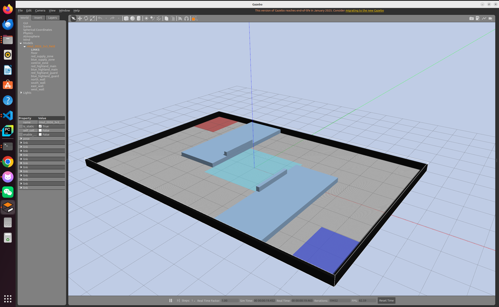

# Sentry Navigation

Robomaster 哨兵机器人导航开发工作空间，目标平台为 Ubuntu 22.04 + ROS 2 Humble。

## 当前内容

- `src/livox_ros_driver2`: Livox MID360 ROS 2 驱动
- `src/rm2026_field`: 可配置的 RMUL 2026 3v3 Gazebo 场地
- `src/rm2027_field`: 根据 2027 规则新建的 3v3 Gazebo 场地（隧道与工作台）
- `src/sentry_description`: 哨兵机器人模型；默认使用 SolidWorks CAD 外观
- `src/sentry_navigation`: 建图、定位、Nav2 自主导航和 RViz 配置
- `src/sentry_solidworks_preview`: SolidWorks 模型的独立静态预览
- `src/sentry_urdf_preview`: 早期 URDF 模型的独立静态预览
- `env.sh`: ROS 2 Humble、工作空间和用户目录 SDK2 环境

## 环境

```bash
source ~/Desktop/workspace/sentry-navigation/env.sh
```

构建：

```bash
cd ~/Desktop/workspace/sentry-navigation
source /opt/ros/humble/setup.bash
colcon build --symlink-install
```

## Gazebo 3v3 地图

### RMUL 2026



```bash
source ~/Desktop/workspace/sentry-navigation/env.sh
ros2 launch rm2026_field rmul_2026_3v3.launch.py
```

场地尺寸和生成方式见 [2026 地图说明](src/rm2026_field/README.md)。

### RMUL 2027


```bash
source ~/Desktop/workspace/sentry-navigation/env.sh
ros2 launch rm2027_field rmul_2027_3v3.launch.py
```

2027 场地增加工作台、隧道桥板和靠墙实体墙；隧道增益区位于桥板靠场地中心的一侧。
尺寸和修改方法见 [2027 地图说明](src/rm2027_field/README.md)。如需同时加载机器人：

```bash
ros2 launch sentry_description gazebo.launch.py field_year:=2027
```

两个 Gazebo 场地一次只启动一个。现有 `rmul_3v3_v2` 导航地图对应 2026 场地，
在 2027 场地使用 Nav2 定位前需要重新建图。

使用完整机器人模型与 Nav2 寻路时，按照
[`src/sentry_navigation/README.md`](src/sentry_navigation/README.md) 依次启动
Gazebo、定位和 RViz。2026 仿真导航使用 `maps/rmul_3v3_v2.yaml`。

## 实机 MID-360 首次联调

开发电脑直连雷达的有线网卡为 `enx207bd294c80c`。以下示例假设雷达仍在
`192.168.1.0/24` 网段，且 `192.168.1.5` 未被占用。本次直连发现雷达地址为
`192.168.1.158`，已写入仓库的驱动配置；若设备 IP
被重新设置，应重新核对并更新该地址。

```bash
sudo nmcli connection modify '有线连接 1' \
  ipv4.method manual ipv4.addresses 192.168.1.5/24 ipv4.never-default yes
sudo nmcli connection up '有线连接 1' ifname enx207bd294c80c
ip -4 addr show dev enx207bd294c80c
printf '请输入雷达实际 IP: '
read -r LIDAR_IP
ping -I enx207bd294c80c -c 3 "$LIDAR_IP"
```

将 `src/livox_ros_driver2/config/MID360_config.json` 中 `lidar_configs[0].ip`
改成雷达 IP，并确认 `host_net_info` 的四个 `*_data_ip` / `push_msg_ip` 都是
`192.168.1.5`。雷达端和主机端的端口保持原值。然后在新终端启动驱动：

```bash
source ~/Desktop/workspace/sentry-navigation/env.sh
ros2 launch sentry_navigation mid360.launch.py \
  config:=$SENTRY_WS_DIR/src/livox_ros_driver2/config/MID360_config.json
```

这会自动打开 RViz，展示实时点云。若需要只运行驱动、不启动图形界面，追加
`rviz:=false`。在 RViz 中拖动左键旋转、滚轮缩放、按住中键平移；左侧
`PointCloud2` 是雷达数据，Fixed Frame 为 `livox_frame`。

驱动将 `PointCloud2` 发布到 `/mid360/points`，将 IMU 发布到 `/mid360/imu`，
坐标系为 `livox_frame`。先单独确认数据，再接入机器人：

```bash
ros2 topic hz /mid360/points
ros2 topic echo /mid360/points --once --field header
ros2 topic hz /mid360/imu
```

RViz 的 Fixed Frame 可先设为 `livox_frame`，订阅 `/mid360/points` 检查原始点云。
实机建图还需要机器人发布 `odom -> base_link` 里程计 TF 和正确的
`base_link -> ... -> livox_frame` 安装/云台 TF；云台运动时必须发布实际编码器角度。
这些就绪后，另开终端运行：

```bash
source ~/Desktop/workspace/sentry-navigation/env.sh
ros2 launch sentry_navigation mapping.launch.py \
  use_sim_time:=false \
  params_file:=$SENTRY_WS_DIR/src/sentry_navigation/config/slam_mapping.yaml
ros2 topic hz /scan
```

`mapping.launch.py` 无参数运行时仍使用 Gazebo 配置。实机地图不能直接使用仿真地图；
在点云、TF 和里程计校准前不要启用自主导航。

## 从开发电脑部署到机载 PC

两台机器分别安装 Ubuntu 22.04、ROS 2 Humble、Livox SDK2 和本工作空间依赖，
在机载 PC 上拉取同一份源码并执行 `colcon build --symlink-install`。`env.sh` 会按
自身位置加载工作空间，所以机载 PC 的用户名和源码目录可以不同；SDK2 如安装在
用户目录，则保持 `$HOME/third_party/livox-sdk2-install` 路径。雷达只连接一台
主机时，两台主机可分别使用 `192.168.1.5/24`，但各自的网卡名可能不同。
在机载 PC 上也要核对雷达 IP，配置有线网卡，并用同一启动命令验证
`/mid360/points` 与 `/mid360/imu`。

先在开发电脑录制实机数据来调试算法，机载 PC 上再做实时验证：

```bash
ros2 bag record /mid360/points /mid360/imu /tf /tf_static /odom
```

场地规则变化时，编辑对应年份的 `config/field_config.json`，运行生成脚本后重新编译：

```bash
python3 src/rm2026_field/scripts/generate_field.py
colcon build --symlink-install --packages-select rm2026_field

python3 src/rm2027_field/scripts/generate_field.py
colcon build --symlink-install --packages-select rm2027_field
```
