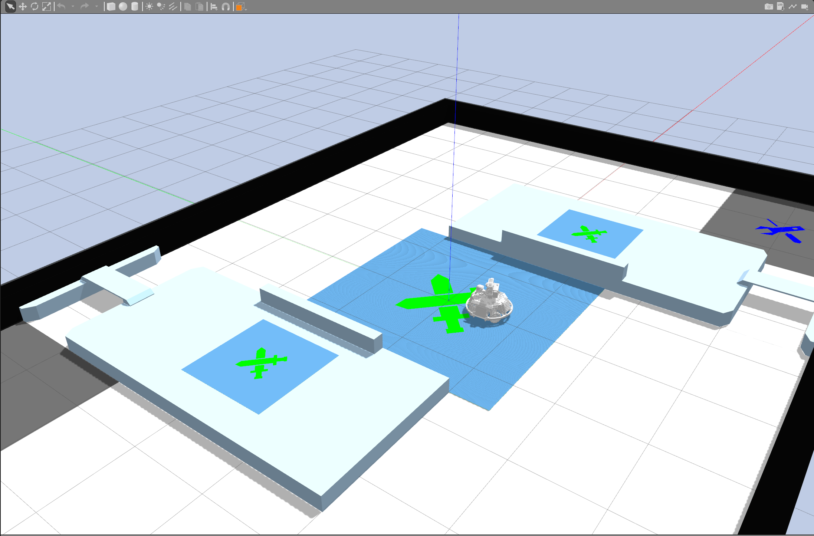

# Sentry Navigation

A RoboMaster sentry navigation workspace for Ubuntu 22.04 and ROS 2 Humble.

## Packages

- `src/livox_ros_driver2`: Livox MID-360 ROS 2 driver
- `src/rm2026_field`: Configurable RMUL 2026 3v3 Gazebo field
- `src/rm2027_field`: RMUL 2027 3v3 Gazebo field converted from the official STEP model
- `src/sentry_description`: Sentry robot model, using the SolidWorks CAD appearance by default
- `src/sentry_navigation`: Mapping, localization, Nav2 navigation, and RViz configuration
- `src/sentry_solidworks_preview`: Standalone static preview of the SolidWorks model
- `src/sentry_urdf_preview`: Standalone static preview of the earlier URDF model
- `env.sh`: ROS 2 Humble, workspace, and user-local SDK2 environment setup

## Environment Setup

```bash
source ~/Desktop/workspace/sentry-navigation/env.sh
```

Build the workspace:

```bash
cd ~/Desktop/workspace/sentry-navigation
source /opt/ros/humble/setup.bash
colcon build --symlink-install
```

## Gazebo 3v3 Fields

### RMUL 2026


```bash
source ~/Desktop/workspace/sentry-navigation/env.sh
ros2 launch rm2026_field rmul_2026_3v3.launch.py
```

See the [2026 field guide](src/rm2026_field/README.md) for dimensions and generation instructions.

### RMUL 2027


Sentry robot in the 2027 field:



```bash
source ~/Desktop/workspace/sentry-navigation/env.sh
ros2 launch rm2027_field rmul_2027_3v3.launch.py
```

The default field is converted from the official `RMUL2027_3V3_V1.0.0.stp`, preserving its geometry and surface colors. See the [2027 field guide](src/rm2027_field/README.md) for the source model, dimensions, and import instructions.

To load the robot into the 2027 field, close the field-only Gazebo instance first, then run:

```bash
ros2 launch sentry_description gazebo.launch.py
```

Run only one Gazebo world at a time. The existing `rmul_3v3_v2` navigation map is for the 2026 field. For 2027 navigation, use `maps/rmul_2027_3v3_nav.yaml`. This map combines the lidar map with raised obstacles from the official STEP model, preventing the planar-motion simulation from routing through highlands and tunnel plates. After creating a new lidar map, regenerate the navigation map with:

```bash
python3 src/sentry_navigation/scripts/prepare_2027_nav_map.py
```

For the full robot and Nav2 navigation workflow, follow the instructions in [`src/sentry_navigation/README.md`](src/sentry_navigation/README.md). The 2026 simulation uses `maps/rmul_3v3_v2.yaml`.

## First MID-360 Hardware Test

The development PC connects directly to the lidar through the `enx207bd294c80c` Ethernet interface. These examples assume the lidar remains on the `192.168.1.0/24` subnet and `192.168.1.5` is unused. The lidar was discovered at `192.168.1.158` during the last direct connection; this address is saved in the driver configuration. If the lidar IP changes, verify and update it.

```bash
sudo nmcli connection modify '有线连接 1' \
  ipv4.method manual ipv4.addresses 192.168.1.5/24 ipv4.never-default yes
sudo nmcli connection up '有线连接 1' ifname enx207bd294c80c
ip -4 addr show dev enx207bd294c80c
printf 'Enter the actual lidar IP: '
read -r LIDAR_IP
ping -I enx207bd294c80c -c 3 "$LIDAR_IP"
```

Set `lidar_configs[0].ip` in `src/livox_ros_driver2/config/MID360_config.json` to the lidar IP. Make sure all four `*_data_ip` and `push_msg_ip` fields in `host_net_info` use `192.168.1.5`. Keep the existing port values. Then start the driver in a new terminal:

```bash
source ~/Desktop/workspace/sentry-navigation/env.sh
ros2 launch sentry_navigation mid360.launch.py \
  config:=$SENTRY_WS_DIR/src/livox_ros_driver2/config/MID360_config.json
```

RViz starts automatically and displays the live point cloud. Add `rviz:=false` to run only the driver. In RViz, drag with the left mouse button to rotate, use the wheel to zoom, and hold the middle button to pan. The `PointCloud2` display shows lidar data; set the Fixed Frame to `livox_frame`.

The driver publishes `PointCloud2` on `/mid360/points` and IMU data on `/mid360/imu`, in the `livox_frame` coordinate frame. Verify the data before integrating the lidar with the robot:

```bash
ros2 topic hz /mid360/points
ros2 topic echo /mid360/points --once --field header
ros2 topic hz /mid360/imu
```

In RViz, set the Fixed Frame to `livox_frame` and subscribe to `/mid360/points` to inspect the raw point cloud. Hardware mapping also requires the robot to publish odometry TF from `odom` to `base_link` and the correct sensor and gimbal TF from `base_link` through to `livox_frame`. Publish the actual encoder angle while the gimbal moves. Once these are ready, run this in another terminal:

```bash
source ~/Desktop/workspace/sentry-navigation/env.sh
ros2 launch sentry_navigation mapping.launch.py \
  use_sim_time:=false \
  params_file:=$SENTRY_WS_DIR/src/sentry_navigation/config/slam_mapping.yaml
ros2 topic hz /scan
```

Without arguments, `mapping.launch.py` uses the Gazebo configuration. Do not use a simulation map on the real field. Wait until the point cloud, TF, and odometry are calibrated before enabling autonomous navigation.

## Deploy from the Development PC to the Onboard PC

Install Ubuntu 22.04, ROS 2 Humble, Livox SDK2, and the workspace dependencies on both machines. Clone the same source on the onboard PC and run `colcon build --symlink-install`. `env.sh` locates the workspace relative to itself, so the onboard PC can use a different username and source directory. If SDK2 is installed under the user directory, keep it at `$HOME/third_party/livox-sdk2-install`. When the lidar connects to one host only, both hosts can use `192.168.1.5/24`, though their interface names may differ.

On the onboard PC, verify the lidar IP and Ethernet configuration, then use the same launch command to check `/mid360/points` and `/mid360/imu`.

Record real hardware data on the development PC for algorithm debugging before running real-time tests on the onboard PC:

```bash
ros2 bag record /mid360/points /mid360/imu /tf /tf_static /odom
```

To update the 2026 field, edit `src/rm2026_field/config/field_config.json`, regenerate the world, and rebuild the package:

```bash
python3 src/rm2026_field/scripts/generate_field.py
colcon build --symlink-install --packages-select rm2026_field
```

The 2027 field is imported from the official STEP model. See the [2027 field guide](src/rm2027_field/README.md) for instructions.
