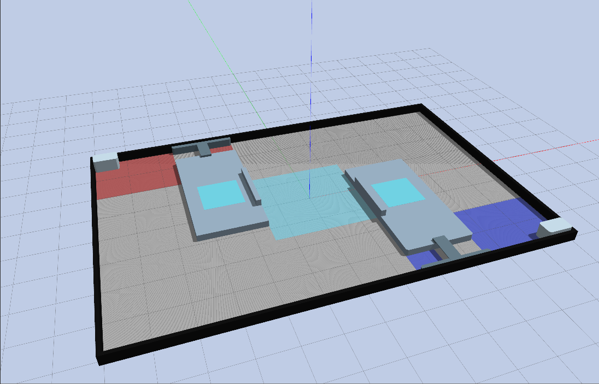

# RMUL 2027 3v3 Gazebo field



This separate Gazebo Classic field is based on section 3.2 and figures 3-1 to
3-10 of the RoboMaster 2027 University League Rules V1.0.0 (2026-10-15).
The 2026 field remains available in `rm2026_field`.

The field is 12 × 8 m and center symmetric. Compared with the 2026 simulation,
this model uses 2.5 × 2 m supply zones, adds a 0.75 × 0.45 × 0.40 m workbench
with 50 mm cuts at all four corners of each supply area, shortens each highland
to 2 × 4.06 m, and leaves an 0.80 m gap to the perimeter. The tunnel has a
chamfered wall-side barrier extending from the floor to 0.25 m, a 0.35 m wide
bridge joining it to the highland, and 50 mm cuts at the highland entrance
corners. The bridge
height rises from 0.25 m at the wall side to 0.27 m at the highland side. It
leaves two 0.825 m wide passages, but the gain zone is marked only in the
passage on the field-center side, using the same color as that team's supply
area. The center control zone is 3 × 3 m and each highland control zone is
1.2 × 1.2 m.

Coordinates are in meters: +X points from red to blue; +Y points toward the
top of the official drawing. Red elements are at the north-west corner and
blue elements are generated by 180° symmetry. Geometry comes from
[`config/field_config.json`](config/field_config.json). Small support details,
the perimeter wall, and some positions are simulation approximations,
especially the wall-side barrier depth and the bridge landing; check them
against the physical field when available.

From the workspace root, build and launch the field alone:

```bash
source env.sh
colcon build --symlink-install --packages-select rm2027_field
ros2 launch rm2027_field rmul_2027_3v3.launch.py
```

To spawn the sentry robot in the 2027 field:

```bash
source env.sh
colcon build --symlink-install --packages-select rm2027_field sentry_description
ros2 launch sentry_description gazebo.launch.py field_year:=2027
```

Run only one Gazebo world at a time. The saved `rmul_3v3_v2` occupancy map is
for the 2026 field; create a new map before starting Nav2 localization in this
2027 field.

After changing the JSON, regenerate the world and model files:

```bash
python3 src/rm2027_field/scripts/generate_field.py
```
