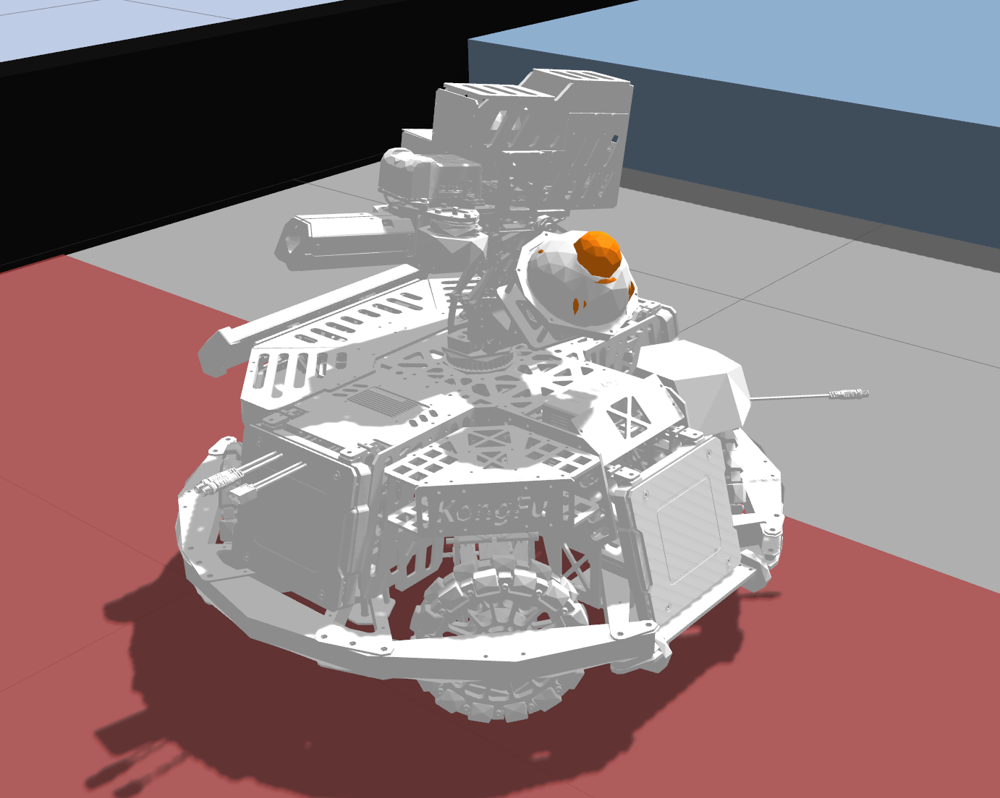

# Sentry Robot Description




ROS 2 Humble description and Gazebo Classic simulation package for the RoboMaster sentry robot.

The model includes the chassis, four suspension and wheel assemblies, a yaw gimbal, and a simulated Livox MID-360. The lidar is attached to the yaw assembly and can sweep with the gimbal to reduce occlusion during mapping and navigation experiments.

## Launch the Simulation

From the workspace root:

```bash
source ~/Desktop/workspace/sentry-navigation/env.sh
ros2 launch sentry_description gazebo.launch.py
```

This launch starts the RMUL 3v3 field and spawns the robot. The simulation uses planar kinematic motion for navigation development; it is not intended to validate chassis dynamics or motor control.

The default visual model is the complete SolidWorks export from `sentry.rar`.
It retains the simulator's `base_link`, gimbal controller, MID360 TF and sensor,
and `/cmd_vel` safety guard. To view the earlier model, add `solidworks:=false`
to the launch command. The SolidWorks wheel joints are currently free-spinning
visual links; the planar motion plugin moves the robot body.

For the separate RMUL 2027 3v3 field with workbenches and tunnel passages,
start Gazebo with `field_year:=2027`. The default is the 2026 field. Build
`rm2027_field` before selecting the new field. The existing 2026 occupancy map
does not match the new field; create a fresh map before using Nav2 there.

To drive the robot through the existing `/cmd_vel` safety guard, start the
mapping launch in a second terminal. It converts `/mid360/points` to `/scan`;
the guard blocks motion until a fresh scan is available.

```bash
source ~/Desktop/workspace/sentry-navigation/env.sh
ros2 launch sentry_navigation mapping.launch.py
```

Then send a short forward command from a third terminal:

```bash
source ~/Desktop/workspace/sentry-navigation/env.sh
ros2 topic pub -r 10 -t 25 /cmd_vel geometry_msgs/msg/Twist '{linear: {x: 0.12}}'
```

The guard stops the robot when the command ends or an obstacle is too close.

## Package Layout

- `urdf/sentry.urdf.xacro`: robot links, joints, sensors, and Gazebo plugins.
- `meshes/`: visual meshes used by the robot model.
- `config/`: controller and simulation parameters.
- `launch/`: Gazebo launch files.

## Related Packages

- `rm2026_field`: configurable RMUL 2026 3v3 field.
- `sentry_navigation`: MID-360 simulation, mapping, localization, and Nav2 configuration.
